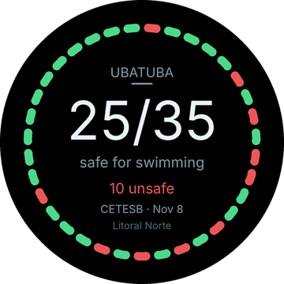
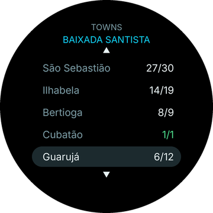
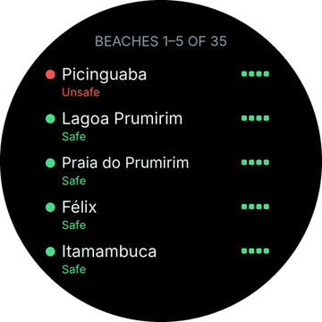
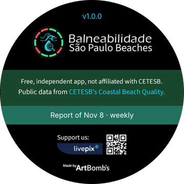
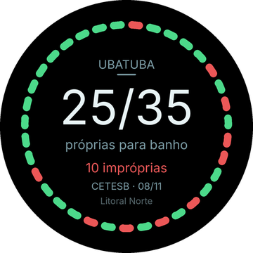
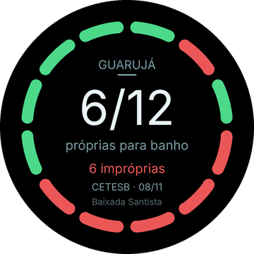
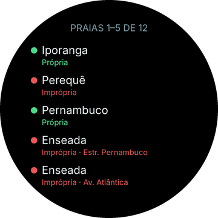
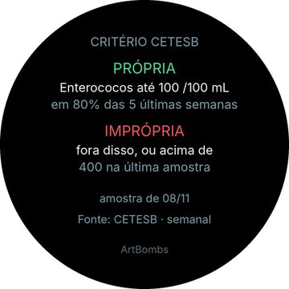

# Balneabilidade Praias SP — mini app Zepp OS

**PT** · Dá pra entrar no mar? A classificação oficial da **CETESB** para as **175 praias do litoral de São Paulo**, no pulso: própria ou imprópria para banho, praia por praia, nos 15 municípios do **Litoral Norte, Baixada Santista e Litoral Sul**, com o histórico das últimas semanas e dados públicos da [Qualidade das Praias Litorâneas](https://cetesb.sp.gov.br/praias/).

**EN** · Is the sea safe for swimming? CETESB's official bathing water ratings for the 175 beaches of the São Paulo coast, on your wrist: safe or unsafe, beach by beach, in 15 municipalities, with the previous weeks, from public data. The interface follows the watch language (English or Portuguese).

App independente, sem vínculo com a CETESB. Não coleta dados pessoais. · *Independent app, not affiliated with CETESB. No personal data collected.*

<p>
  
  
  
  
</p>
<p>
  
  
  
  
</p>

## Telas

1. **Resumo do município**: anel com um segmento por praia (verde = própria, vermelho = imprópria, cinza = sem classificação), placar (ex.: 25/35), data da amostra e região. Toque no nome do município, ou clique da coroa, para trocar de município.
2. **Praias** (1 a 7 telas, 5 praias cada, conforme o município): nome, situação, local e as 4 semanas anteriores (quadradinhos à direita).
3. **Critério CETESB**: regra de enterococos para água do mar (Resolução CONAMA 274).
4. **Sobre**: versão, data do boletim e QR de apoio (toque para ampliar).

**Lista de municípios**: os 15, de norte a sul (Ubatuba → Ilha Comprida), com o placar de cada um e a região no título. Coroa: girar move o cursor, clicar escolhe. Toque: linha escolhe, ▲▼ rolam, "MUNICÍPIOS" fecha.

## Relógios

Zepp OS com API 3.0+ e tela **redonda de 480 px** (a arte do Sobre não escala): Amazfit Balance, Balance 2, Balance 2 XT, Balance 3, Balance 3 Ti, Balance Ultra, T-Rex 3, T-Rex 3 Pro (48 mm), T-Rex Ultra 2, Cheetah 2 Ultra, Active Max e Cheetah Pro.

## Arquitetura

```
Relógio (page)  ──BLE──►  Zepp App (app-side)  ──HTTPS──►  arcgis.cetesb.sp.gov.br (2 camadas ArcGIS)
  cache por município       cache por município            JSON público, sem chave
```

- O relógio não acessa a internet: quem consulta a CETESB é o **side service** dentro do Zepp App (`app-side/index.js`), via [ZML](https://github.com/zepp-health/zml).
- Ao abrir, o app mostra na hora o último pacote salvo do município e depois busca o novo. Sem conexão, fica o último salvo, marcado como offline.
- A cada consulta o side service faz 3 pedidos pequenos: as praias do município escolhido (~6 KB em Ubatuba), o placar de todos os municípios já agrupado pelo servidor (~2,5 KB) e o histórico do município (~15 KB). Só o primeiro é obrigatório; cada um tenta de novo uma vez. O relógio recebe um pacote compacto: ~3,6 KB para Ubatuba (35 praias), ~1,1 KB para Cubatão.
- Até a v1.0.0 o app baixava as 175 praias numa resposta só (~45 KB) e o fetch do Zepp App falhava com "network error". Se ainda falhar, o rodapé mostra a etapa: **P** (praias), **M** (municípios) ou **H** (histórico).

## Estrutura

| Caminho | Conteúdo |
|---|---|
| `page/index/index.page.js` | Resumo, telas de praias (número variável), critério, Sobre + QR, lista de municípios, coroa |
| `page/i18n.js` | Idioma pelo `getLanguage()` do relógio: português (pt-BR/pt-PT) ou inglês |
| `app-side/index.js`, `shared/praias.js` | Consulta às camadas da CETESB, nomes das praias, histórico e pacote compacto para o relógio |
| `tools/` | Capturas da loja a partir dos widgets, arte do Sobre em inglês, arte de divulgação, build preview para QR |
| `test/` | Simulação do Zepp OS (mocks de `@zos/*`) com respostas reais da CETESB de 17/11/2026 |

## Dados da CETESB (públicos, sem chave)

| Camada | Uso |
|---|---|
| `Hosted/Praias/FeatureServer/0` ("Praias_v3") | Retrato atual das 175 praias, uma linha por praia |
| `Hosted/Praias_Amostragem/FeatureServer/4` ("Praias_Coletas") | Histórico semanal por praia desde 29/10/2023 |

```
# praias de um município
.../Hosted/Praias/FeatureServer/0/query?f=json&returnGeometry=false&orderByFields=ordem
  &outFields=ordem,id_praia,praia,qualidade,classificacao_texto,data_amostra_final&where=id_municipio='701'
# placar por município (agrupado no servidor)
.../Hosted/Praias/FeatureServer/0/query?f=json&where=1=1&groupByFieldsForStatistics=id_municipio,municipio,ugrhi
  &outStatistics=[count(id_praia) t, sum(qualidade) p, min(ordem) o]
```

- `qualidade`: 1 = própria, 0 = imprópria. `ordem` dá a sequência norte → sul (as praias da Ilha Anchieta vêm sem `ordem` e ficam no fim de Ubatuba).
- Critério CETESB (água do mar): própria com enterococos até 100 UFC/100 mL em 80% das 5 semanas anteriores; imprópria fora disso ou acima de 400 na última amostra.
- Nome "PRAIA - LOCAL" vira duas linhas: "Enseada" / "Av. Atlântica". Só separa em hífen seguido de espaço ("Perequê-Açu" fica inteiro). Dois pontos com o mesmo nome e sem local (Itaguá, em Ubatuba) recebem "#1" e "#2".
- O histórico às vezes repete a mesma data de coleta: as duplicatas são descartadas.
- Nomes de praias, municípios e locais não são traduzidos.

## Compilar

Requer Node.js e a [Zeus CLI](https://docs.zepp.com/docs/guides/tools/cli/).

```bash
npm install
zeus preview                 # instala no relógio pelo QR (Zepp App › modo desenvolvedor)
zeus build                   # gera dist/*.zab (modo production) para a loja
node tools/build_preview.js  # gera dist/*.zab em modo preview, todos os relógios: os .zpk de dentro servem para QR zpkd1://
```

O scanner do modo desenvolvedor do Zepp App só aceita pacotes **preview** ("Only preview packages are supported"). Por isso o `.zab` da loja (production) e os `.zpk` para QR saem de comandos diferentes.

O `appId` 1136754 é registrado no Zepp Console do autor. Para publicar um fork, registre um app próprio e troque o `appId` no `app.json`.

## Testes

```bash
node test/harness.mjs                 # português
LANG_ZEPP=2 node test/harness.mjs     # inglês (2 = en-US)
```

## Veja também

[Balneabilidade Represas SP](https://github.com/ArtBombs/App-Balneabilidade-Represas-SP-ZeppOS): as praias das represas da Grande São Paulo (Guarapiranga, Billings, Rio Grande e Cantareira).

## Licença

- **Código** (`.js`, `.mjs`, `.py`): [MIT](LICENSE).
- **Arte** (ícone, tela Sobre, QR em `assets/` e as imagens de `docs/`) e a marca **ArtBombs**: todos os direitos reservados, ver [ASSETS-LICENSE.md](ASSETS-LICENSE.md).
- Os dados são da CETESB (Qualidade das Praias Litorâneas), consultados em tempo real; este repositório não os redistribui, exceto amostras para testes.

Feito por **ArtBombs**.
